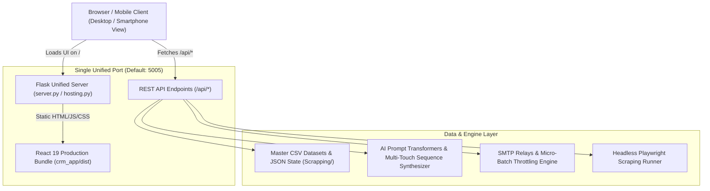

# 🚀 ApexOutreach CRM & Campaign Studio — Hosting & Architecture Guide

ApexOutreach Studio is a production-ready, full-stack B2B CRM, Google Maps lead generation engine, and automated multi-channel cold outreach platform.

---

## 🏛️ System Architecture



---

## ⚡ Quick Start: One-Command Hosting

### 1. Windows Batch Launchers
Double-click or run from command prompt:
```cmd
hosting.bat
```
*(or run `host.bat` or `start_crm_app.bat`)*

### 2. Python Hosting CLI
```bash
# Standard Unified Production Hosting on Port 5005
python hosting.py

# Host on custom port (e.g., 8080 or 80)
python hosting.py --port 8080

# Rebuild frontend bundle before hosting
python hosting.py --build

# Run in headless/cloud server mode without auto-opening a browser
python hosting.py --no-browser

# Run in live split-server development mode (Vite 3000 + Flask 5005)
python hosting.py --dev
```

### 3. NPM Scripts
From the project root:
```bash
npm run host      # Hosts the unified production server
npm run build     # Compiles the React frontend
npm run dev       # Launches split dev mode
```

---

## 🌐 Network Access & URL Structure

Once invoked with hosting, the engine provides:

| Interface | URL | Description |
| :--- | :--- | :--- |
| **Frontend Web App** | `http://localhost:5005/` | Complete React 19 Single Page App |
| **Local Network Access** | `http://<YOUR-LAN-IP>:5005/` | Access CRM from phones, tablets, or other office PCs |
| **Backend REST APIs** | `http://localhost:5005/api/` | All 25+ CRM, Campaign, AI, and Scraper endpoints |
| **Live Lead CSV Downloads** | `http://localhost:5005/api/download-csv?file=MASTER_CRM` | Direct export of filtered master datasets |

---

## ☁️ Cloud & Production Deployment

### Option A: PaaS Hosting (Render / Railway / Heroku)
The repository includes a ready-to-use [`Procfile`](file:///d:/Dinesh/antigravity/Procfile):
```procfile
web: python hosting.py --no-browser
```
Environment Variables to set in your cloud dashboard:
- `PORT`: (Auto-injected by provider)
- `HOST`: `0.0.0.0`

### Option B: Docker Container
The repository includes a multi-stage [`Dockerfile`](file:///d:/Dinesh/antigravity/Dockerfile):
```bash
# Build the container image
docker build -t apexoutreach-crm .

# Run container on port 5005
docker run -d -p 5005:5005 --name apexoutreach apexoutreach-crm
```

### Option C: Linux VPS (Systemd Service)
Create `/etc/systemd/system/apexoutreach.service`:
```ini
[Unit]
Description=ApexOutreach CRM & Campaign Studio
After=network.target

[Service]
User=ubuntu
WorkingDirectory=/var/www/antigravity
ExecStart=/usr/bin/python3 hosting.py --no-browser --port 5005
Restart=always
Environment=HOST=0.0.0.0
Environment=PORT=5005

[Install]
WantedBy=multi-user.target
```

---

## 🛠️ Core Functional Modules

1. **Master CRM & Kanban Pipeline**:
   - Smart query filtering (e.g. `min_rating:4.5`, `has_email:true`, `high-priority`).
   - Fuzzy matching and deduplication on CSV and scraper imports.
   - Interactive drag-and-drop Kanban board view (`New`, `Contacted`, `Interested`, `Follow-up`, `Converted`, `Do Not Contact`).
   - Automated Priority Scoring (0–100) based on review volume, corporate email validity, and phone directness.
   - Lead engagement timeline drawer with follow-up scheduling, calendar snooze, and task completion.

2. **In-App Campaign Studio**:
   - **Dynamic Industry Switcher**: 5 preset sectors (*Manufacturing*, *B2B Tech*, *Logistics*, *Real Estate*, *Professional Services*).
   - **Universal AI Message Polishers**: *Value-First Prospecting*, *Pain-Point Agitator*, *Case Study / Social Proof*, and *Short & Punchy (<60 words)*.
   - **Real-Time Rendered Card Preview**: Instant HTML card preview with desktop and mobile phone toggles.
   - **Micro-Batch Queue Throttling**: Burst delivery with randomized jitter intervals (e.g. 3 emails/burst with 10s cooldown) to protect sender reputation.

3. **Multi-Channel Automation**:
   - WhatsApp Web automated session linking and template queue runner.
   - Daily cron dispatcher with automated quiet-hour safeguards.
